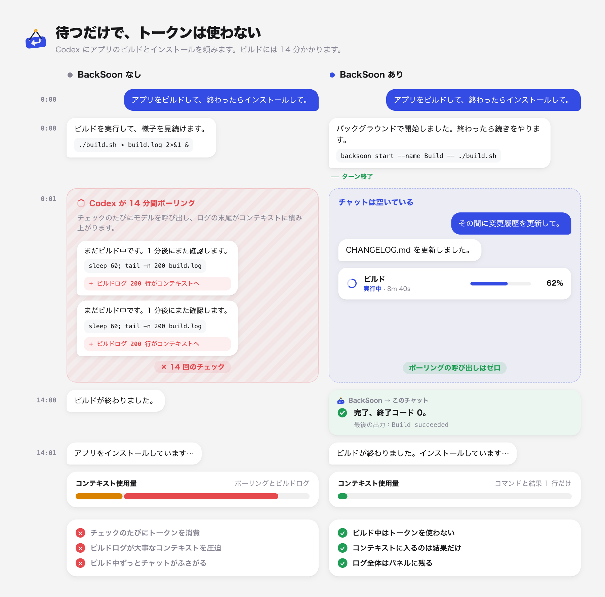
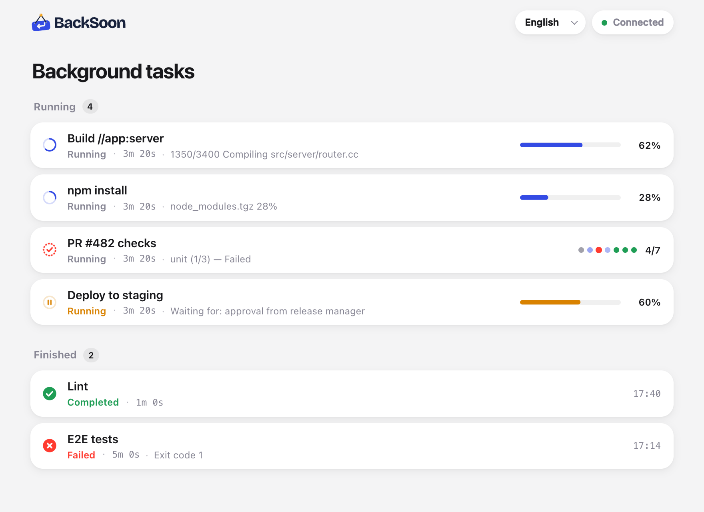

<h1 align="center"><a href="https://backsoon.dev"></a></h1>

<p align="center"><a href="https://backsoon.dev">backsoon.dev</a> / <a href="README.md">English</a> / <a href="README.zh-CN.md">简体中文</a> / <a href="README.zh-TW.md">繁體中文</a> / <a href="README.ja.md">日本語</a> / <a href="README.ko.md">한국어</a></p>

BackSoon を使うと、Codex は時間のかかるコマンドを見張り続けずに任せられます。コマンドを開始したらすぐにターンを終えるので、ポーリングでトークンを使うことも、長いログで大切なコンテキストを埋めることもありません。終わると短い結果だけが元のチャットに届き、その間はローカルのパネルで各タスクの状況を確認できます。

## インストール

macOS または Linux と、npm を含む Node.js 22 以降が必要です。

```sh
npm i -g backsoon
backsoon setup
```

setup はスキルをインストールし、完了通知を登録します。Codex のサイドパネルまたは既定のブラウザーでガイドが開き、完了通知を許可する手順を確認できます。ガイドでは共通の `AGENTS.md` に追加するおすすめのルールも表示され、追加、スキップ、後からの削除を選べます。ブラウザーがない環境では、setup がターミナルで確認します。事前に決めるには `--rules` または `--no-rules`、ガイドを省略するには `--no-open`、スキルだけを追加するには `--skill-only` を使用してください。 セットアップが終わると、ガイドから約 40 秒のサンプルタスクを Codex に送れます。パネルに進み具合が表示され、結果がチャットに戻る様子を確認できます。もう一度試すには、`backsoon demo` を実行するよう Codex に頼んでください。

<picture>
  <source media="(prefers-color-scheme: dark)" srcset="docs/images/session-dark.ja.png">
  
</picture>

## できること

- **トークンもコンテキストも節約。** コマンドの実行中、Codex はポーリングしないので、待つだけならコストはかかりません。チャットに届くのは短い結果だけで、ログ全体はパネルとローカルのファイルに残ります。
- **作業をバックグラウンドで実行。** ビルド、テスト、デプロイ、時間のかかるスクリプトを裏で動かし続け、チャットは次の作業に移るかターンを終えられます。
- **結果は元のチャットへ。** コマンドが終わると、開始した Codex チャットに結果が届きます。進行中のターンに直接送るか、キューに入れるか、チャットを再開させるかを選べます。
- **すべてのタスクがひと目で分かる。** ローカルパネルが各タスクの状況を示します。進捗率、CI チェックごとのドット、何を待っているか、どう終わったか。タスクを開くとコマンド、ライブ出力、詳細を確認できます。
- **よく使うツールを理解。** 出力からパーセント表示、Bazel のアクション数、Node のテスト結果、Playwright の実行とダウンロードを読み取り、`gh pr checks` と `gh run watch` はチェックごとに追跡します。出力のない Git 転送は経過時間を表示します。
- **独自の作業も計測。** 小さな進捗スクリプトで、進捗率、段階、待ちの理由、完了予想時刻、ジョブごとの進捗を報告できます。
- **実行中にお知らせ。** 特定のログ行、スクリプトが報告した条件、制限時間の超過をチャットに通知します。
- **動いているものも見守る。** 既存のプロセスを監視したり、ほかの Codex チャットのターン終了を待ったりできます。
- **5 か国語に対応。** 端末、通知、パネルは英語、簡体字中国語、繁体字中国語、日本語、韓国語で使えます。

<picture>
  <source media="(prefers-color-scheme: dark)" srcset="docs/images/panel-dark.png">
  
</picture>

## ドキュメント

| ドキュメント | 内容 |
| --- | --- |
| [はじめに](docs/ja/getting-started.md) | 試し方、インストール、言語の設定 |
| [使い方（英語）](docs/usage.md) | コマンド、パネル、チャット通知、タスクデータ |
| [進捗とアラート（英語）](docs/progress.md) | 進捗スクリプト、完了予想、アラート |
| [開発への参加（英語）](CONTRIBUTING.md) | 開発環境、テスト、翻訳の追加 |
