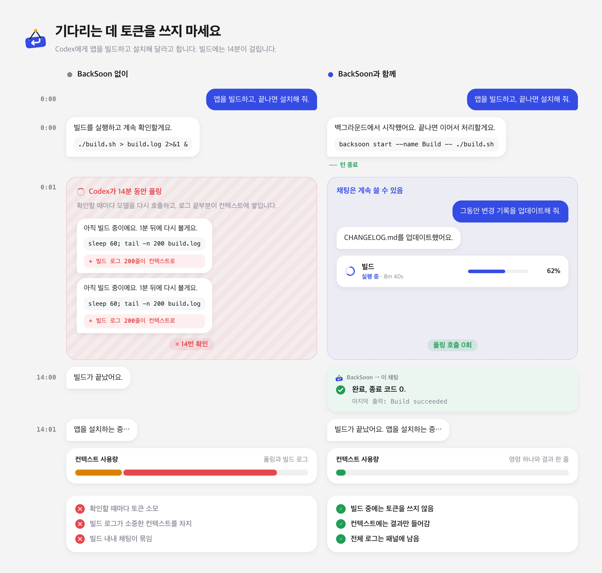
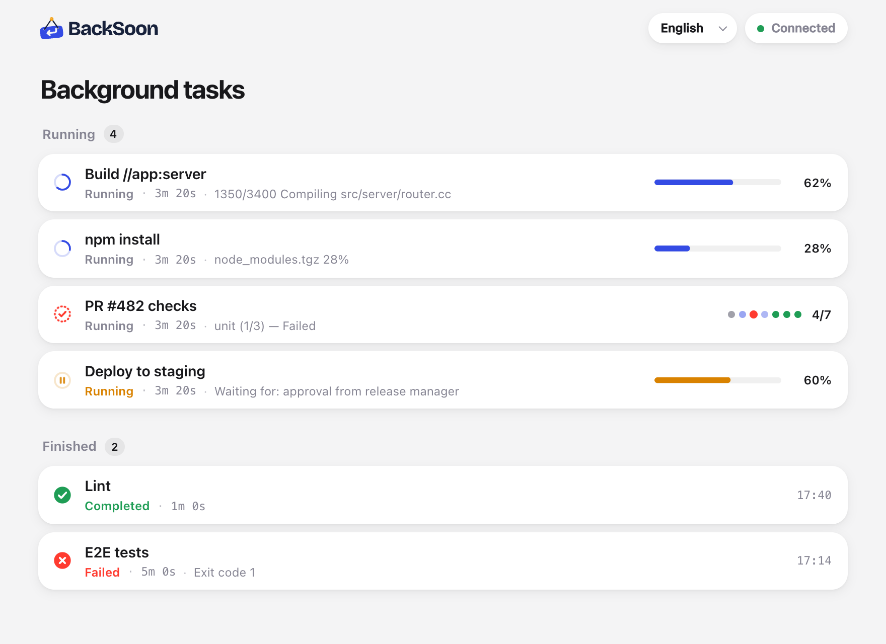

<h1 align="center"><a href="https://backsoon.dev"></a></h1>

<p align="center"><a href="https://backsoon.dev">backsoon.dev</a> / <a href="README.md">English</a> / <a href="README.zh-CN.md">简体中文</a> / <a href="README.zh-TW.md">繁體中文</a> / <a href="README.ja.md">日本語</a> / <a href="README.ko.md">한국어</a></p>

BackSoon을 쓰면 Codex가 오래 걸리는 명령을 지켜보며 기다리지 않고 맡겨 둘 수 있습니다. 명령을 시작하고 바로 턴을 끝내므로 폴링에 토큰을 쓰지 않고, 긴 로그가 소중한 컨텍스트를 채우지도 않습니다. 명령이 끝나면 짧은 결과만 시작한 채팅으로 돌아오고, 그동안 로컬 패널에서 모든 작업의 상태를 볼 수 있습니다.

## 설치

macOS 또는 Linux와 npm이 포함된 Node.js 22 이상이 필요합니다.

```sh
npm i -g backsoon
backsoon setup
```

setup은 스킬을 설치하고 완료 알림을 등록합니다. Codex 사이드 패널이나 기본 브라우저에서 설정 안내가 열리면 완료 알림을 승인할 수 있습니다. 안내에서는 전역 `AGENTS.md`에 넣을 권장 규칙도 보여 주며, 추가하거나 건너뛰고 나중에 제거할 수 있습니다. 브라우저가 없으면 setup이 터미널에서 묻습니다. 미리 정하려면 `--rules` 또는 `--no-rules`, 안내를 건너뛰려면 `--no-open`, 스킬만 설치하려면 `--skill-only`를 사용하세요.

<picture>
  <source media="(prefers-color-scheme: dark)" srcset="docs/images/session-dark.ko.png">
  
</picture>

## 할 수 있는 일

- **토큰과 컨텍스트를 아낍니다.** 명령이 실행되는 동안 Codex는 폴링하지 않으므로 기다리는 데 비용이 들지 않습니다. 채팅에는 짧은 결과만 오고, 전체 로그는 패널과 로컬 파일에 남습니다.
- **작업을 백그라운드에서 실행합니다.** 빌드, 테스트, 배포, 오래 걸리는 스크립트가 뒤에서 계속 돌고, 채팅은 다른 일을 하거나 이번 턴을 끝낼 수 있습니다.
- **결과를 원래 채팅으로 보냅니다.** 명령이 끝나면 시작한 Codex 채팅으로 결과가 갑니다. 진행 중인 턴에 바로 보내거나, 대기열에 넣거나, 채팅을 다시 이어가게 할 수 있습니다.
- **모든 작업을 한눈에 봅니다.** 로컬 패널이 각 작업의 상태를 보여 줍니다. 진행률, CI 검사마다 하나의 점, 무엇을 기다리는지, 어떻게 끝났는지. 작업을 열면 명령, 실시간 출력, 세부 정보를 볼 수 있습니다.
- **자주 쓰는 도구를 이해합니다.** 출력에서 퍼센트, Bazel 액션 수, Node 테스트 결과, Playwright 실행과 다운로드를 읽고, `gh pr checks`와 `gh run watch`는 검사마다 추적합니다. 출력 없는 Git 전송은 경과 시간을 보여 줍니다.
- **직접 만든 작업도 측정합니다.** 작은 진행 상황 스크립트로 진행률, 단계, 막힌 이유, 예상 완료 시각, 작업별 진행 상황을 보고할 수 있습니다.
- **실행 중에 알려 줍니다.** 특정 로그 줄, 스크립트가 보고한 조건, 제한 시간 초과를 채팅으로 알립니다.
- **이미 실행 중인 것도 지켜봅니다.** 기존 프로세스를 관찰하거나 다른 Codex 채팅이 턴을 마칠 때까지 기다릴 수 있습니다.
- **다섯 가지 언어를 지원합니다.** 터미널, 알림, 패널을 영어, 중국어 간체, 중국어 번체, 일본어, 한국어로 사용할 수 있습니다.

<picture>
  <source media="(prefers-color-scheme: dark)" srcset="docs/images/panel-dark.png">
  
</picture>

## 문서

| 문서 | 내용 |
| --- | --- |
| [시작하기](docs/ko/getting-started.md) | 체험, 설치, 언어 설정 |
| [사용 설명서 (영어)](docs/usage.md) | 명령, 패널, 채팅 알림, 작업 데이터 |
| [진행 상황과 알림 (영어)](docs/progress.md) | 진행 상황 스크립트, 예상 완료 시각, 알림 |
| [기여 가이드 (영어)](CONTRIBUTING.md) | 개발 환경, 테스트, 번역 추가 |
