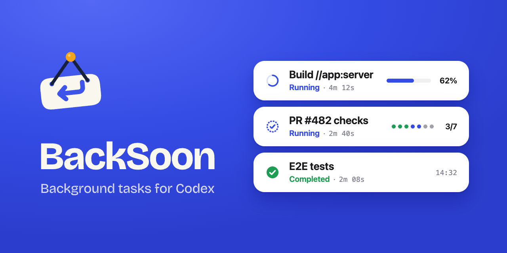
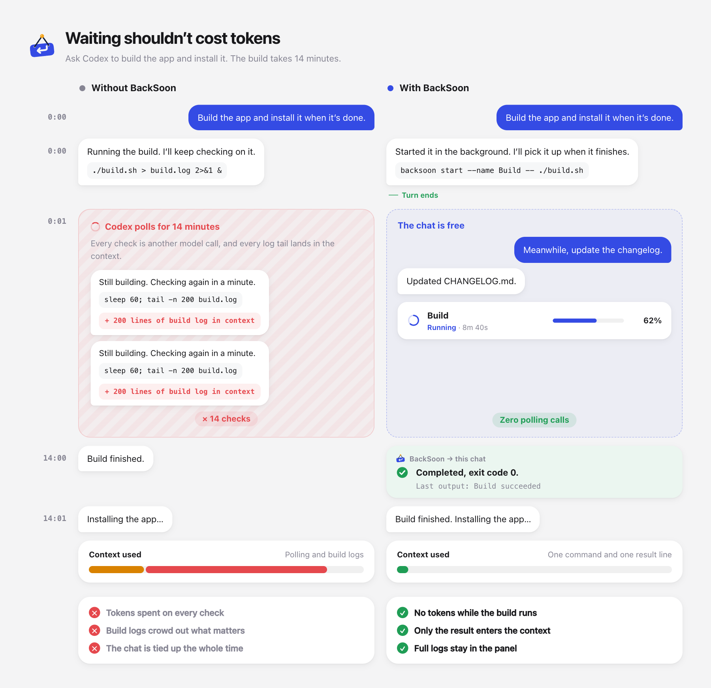
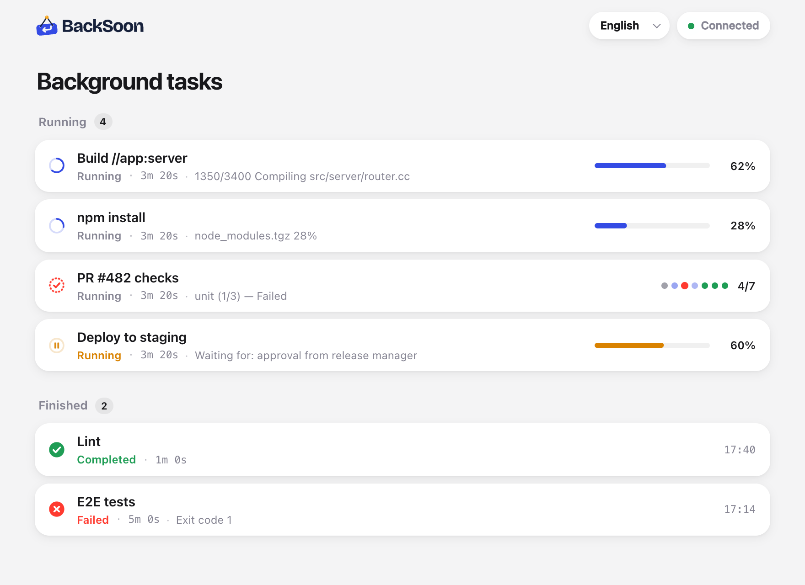
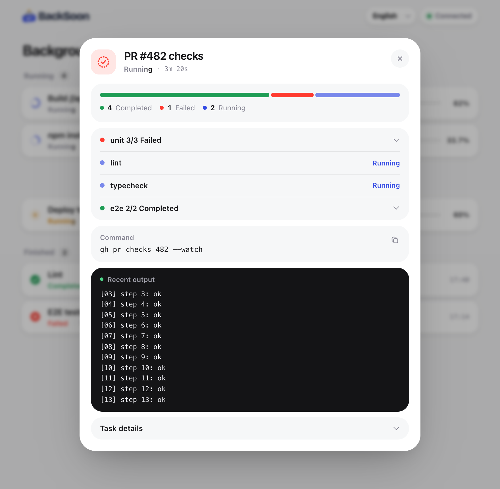

<h1 align="center"><a href="https://backsoon.dev"></a></h1>

<p align="center"><a href="https://backsoon.dev">backsoon.dev</a> / <a href="README.md">English</a> / <a href="README.zh-CN.md">简体中文</a> / <a href="README.zh-TW.md">繁體中文</a> / <a href="README.ja.md">日本語</a> / <a href="README.ko.md">한국어</a></p>

BackSoon lets Codex hand off long commands instead of babysitting them. Codex starts the command and ends its turn, so no tokens go into polling and build logs stay out of its context. When the command finishes, a short result comes back to the chat that started it, and a local panel shows every task in the meantime.

## Install

Requires macOS or Linux and Node.js 22 or later with npm.

```sh
npm i -g backsoon
backsoon setup
```

Setup installs the skill and registers completion notifications. The setup guide opens in the Codex side panel or your default browser. It shows how to authorize the notifications and offers a recommended rule for your global `AGENTS.md`, which you can add, skip or remove later. Without a browser, setup asks in the terminal. Use `--rules` or `--no-rules` to decide up front, `--no-open` to skip the guide, or `--skill-only` to install just the skill.

<picture>
  <source media="(prefers-color-scheme: dark)" srcset="https://raw.githubusercontent.com/chentyke/backsoon/main/docs/images/session-dark.png">
  
</picture>

## What it does

- **Saves tokens and context.** Codex doesn’t poll while a command runs, so waiting costs nothing. Only a short result reaches the chat; the full log stays in the panel and on disk.
- **Runs work in the background.** Builds, test runs, deploys and long scripts keep going while the chat moves on or ends its turn.
- **Reports back to the right chat.** When a command ends, the result reaches the Codex chat that started it: delivered to the active turn, queued, or used to resume the chat.
- **Shows every task at a glance.** The local panel tells you what each task is doing: a percentage, one dot per CI check, what it is waiting for, or how it ended. Open a task for its command, live output and details.
- **Understands common tools.** It reads percentages, Bazel action counts, Node test summaries, Playwright runs and downloads from output, follows `gh pr checks` and `gh run watch` check by check, and shows elapsed time for quiet Git transfers.
- **Measures your own work.** A small progress script can report percentages, stages, blockers, finish-time estimates and per-job steps.
- **Alerts you while it runs.** Alerts reach the chat on a matching output line, a condition your script reports, or after a time limit.
- **Watches what is already running.** Attach to an existing process, or wait for other Codex chats to finish a turn.
- **Speaks your language.** The terminal, notifications and panel are available in English, Simplified Chinese, Traditional Chinese, Japanese and Korean.

<picture>
  <source media="(prefers-color-scheme: dark)" srcset="https://raw.githubusercontent.com/chentyke/backsoon/main/docs/images/panel-dark.png">
  
</picture>

<picture>
  <source media="(prefers-color-scheme: dark)" srcset="https://raw.githubusercontent.com/chentyke/backsoon/main/docs/images/window-dark.png">
  
</picture>

## Documentation

| Guide | What’s inside |
| --- | --- |
| [Getting started](docs/getting-started.md) | Try it, install it and choose a language |
| [Usage](docs/usage.md) | Commands, the panel, chat notifications, watching processes and chats, task data |
| [Progress and alerts](docs/progress.md) | Progress scripts, finish-time estimates and alerts |
| [Contributing](CONTRIBUTING.md) | Development setup, tests and translations |
| [Brand guide](brand/README.md) | Logos, colors and the panel’s look |
