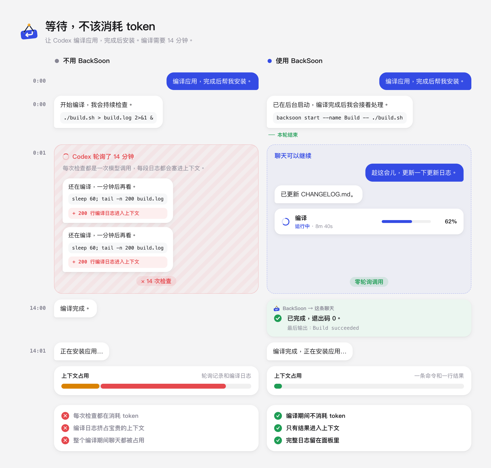
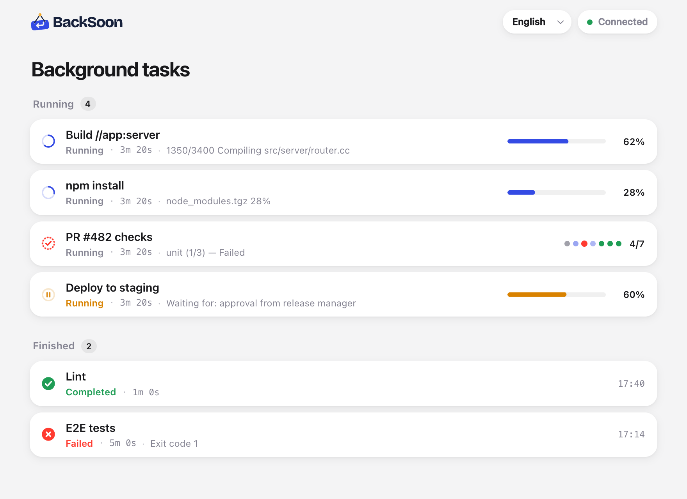
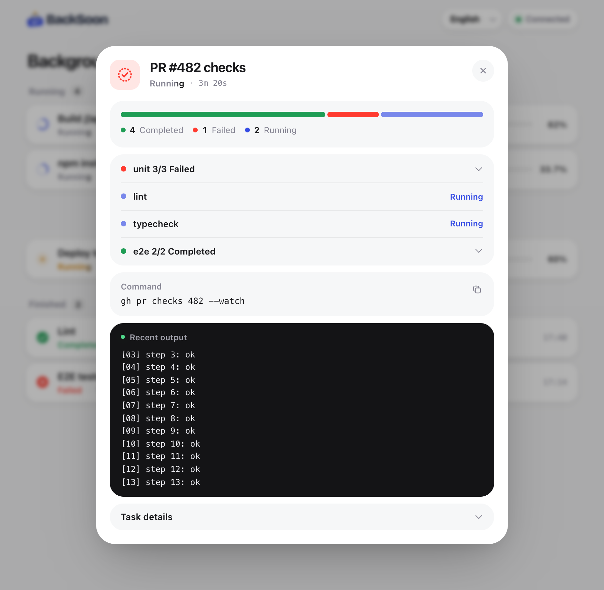

<h1 align="center"><a href="https://backsoon.dev"></a></h1>

<p align="center"><a href="https://backsoon.dev">backsoon.dev</a> / <a href="README.md">English</a> / <a href="README.zh-CN.md">简体中文</a> / <a href="README.zh-TW.md">繁體中文</a> / <a href="README.ja.md">日本語</a> / <a href="README.ko.md">한국어</a></p>

BackSoon 让 Codex 把耗时命令交出去，而不是守在旁边等。Codex 启动命令后就结束本轮，不再反复轮询消耗 token，冗长的日志也不会挤进宝贵的上下文。命令结束后，一条简短的结果回到发起它的聊天；期间本机面板随时显示每个任务的状态。

## 安装

需要 macOS 或 Linux，以及自带 npm 的 Node.js 22 或更高版本。

```sh
npm i -g backsoon
backsoon setup
```

setup 会安装技能并注册任务完成通知。安装引导会在 Codex 右侧或系统浏览器中打开，带你授权完成通知，并推荐在全局 `AGENTS.md` 加入一条 BackSoon 规则；你可以加入、略过，之后也能移除。没有浏览器时，setup 会在终端询问。用 `--rules` 或 `--no-rules` 预先决定，用 `--no-open` 跳过引导，或用 `--skill-only` 只安装技能。设置完成后，引导页可以让 Codex 运行一个约 40 秒的示例任务，让你看到面板显示进度、结果回到对话。之后想再看一次，可以让 Codex 运行 `backsoon demo`。

<picture>
  <source media="(prefers-color-scheme: dark)" srcset="docs/images/session-dark.zh-CN.png">
  
</picture>

## 能做什么

- **省 token，也省上下文。** 命令运行期间 Codex 不用轮询，等待不花一分 token。只有简短的结果回到聊天，完整日志留在面板和本地文件里。
- **在后台跑任务。** 编译、测试、部署和耗时脚本在后台继续，聊天可以接着做别的事，或直接结束本轮。
- **结果回到原来的聊天。** 命令结束后，结果会送回发起它的 Codex 聊天：直接送入正在进行的回复、放进队列，或唤醒聊天继续处理。
- **一眼看清每个任务。** 本机面板说明每个任务在做什么：进度百分比、每项 CI 检查一个圆点、正在等什么，或者最后的结果。点开任务可查看命令、实时输出和详情。
- **读懂常用工具。** 直接从输出识别百分比、Bazel 步数、Node 测试结果、Playwright 运行和下载进度，逐项跟踪 `gh pr checks` 与 `gh run watch` 的检查，没有输出的 Git 传输也会显示已用时间。
- **测量自己的工作。** 写一个小小的进度脚本，就能报告百分比、阶段、卡点、预计完成时间和分项进度。
- **运行中及时提醒。** 日志出现指定内容、脚本报告的条件成立或运行超时，都会提醒到聊天。
- **照看已在运行的东西。** 可以接管观察已有的进程，也可以等待其他 Codex 聊天完成这一轮。
- **支持五种语言。** 终端、通知和面板都提供英语、简体中文、繁体中文、日语和韩语。

<picture>
  <source media="(prefers-color-scheme: dark)" srcset="docs/images/panel-dark.png">
  
</picture>

<picture>
  <source media="(prefers-color-scheme: dark)" srcset="docs/images/window-dark.png">
  
</picture>

## 文档

| 文档 | 内容 |
| --- | --- |
| [快速开始](docs/zh-CN/getting-started.md) | 试用、安装和选择语言 |
| [使用说明](docs/zh-CN/usage.md) | 命令、面板、聊天通知、等待聊天、观察进程和运行中提醒 |
| [自定义进度](docs/zh-CN/progress.md) | 进度脚本和预计完成时间 |
| [贡献指南](CONTRIBUTING.md) | 开发环境、测试和添加翻译（英文） |
| [品牌指南](brand/README.zh-CN.md) | 标志、色彩和面板风格 |
