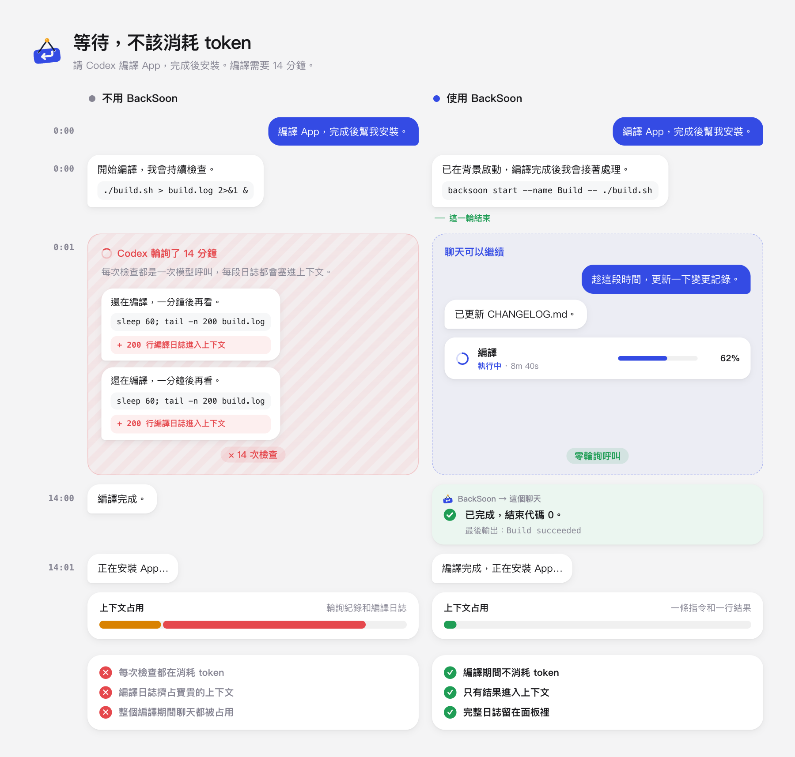
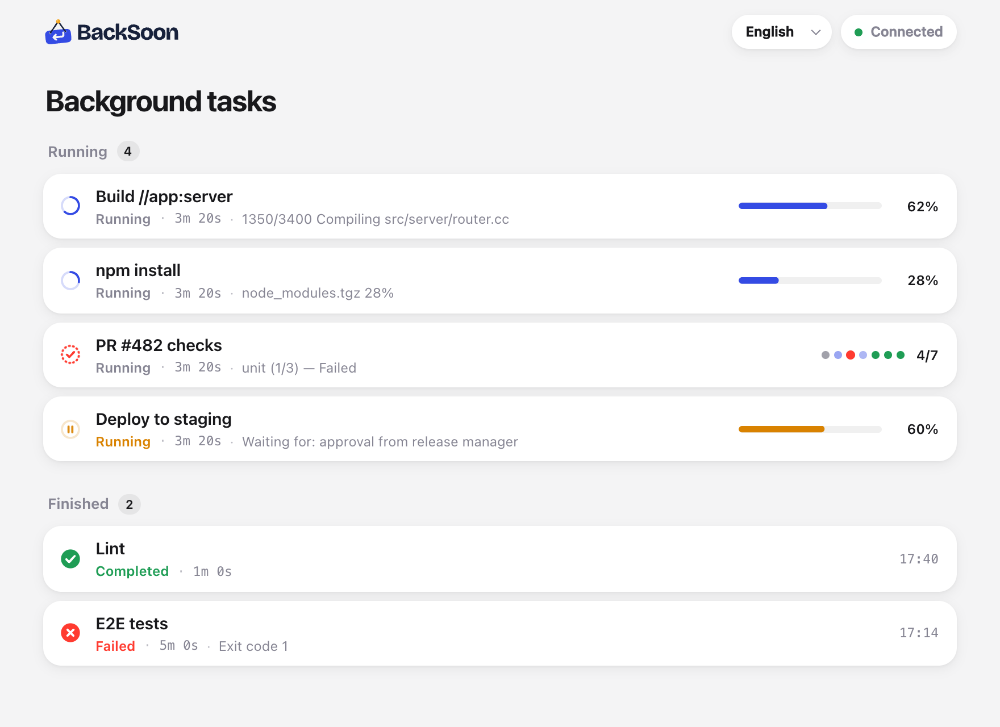

<h1 align="center"><a href="https://backsoon.dev"></a></h1>

<p align="center"><a href="https://backsoon.dev">backsoon.dev</a> / <a href="README.md">English</a> / <a href="README.zh-CN.md">简体中文</a> / <a href="README.zh-TW.md">繁體中文</a> / <a href="README.ja.md">日本語</a> / <a href="README.ko.md">한국어</a></p>

BackSoon 讓 Codex 把耗時的指令交出去，而不是守在旁邊等。Codex 啟動指令後就結束這一輪，不再反覆輪詢消耗 token，冗長的日誌也不會擠進寶貴的上下文。指令結束後，一則簡短的結果會回到發起它的聊天；這段期間，本機面板隨時顯示每個任務的狀態。

## 安裝

需要 macOS 或 Linux，以及內含 npm 的 Node.js 22 或更新版本。

```sh
npm i -g backsoon
backsoon setup
```

setup 會安裝技能並註冊任務完成通知。安裝指南會在 Codex 側邊面板或系統瀏覽器開啟，引導你授權完成通知，並推薦在全域 `AGENTS.md` 加入一條 BackSoon 規則；你可以加入、略過，之後也能移除。沒有瀏覽器時，setup 會在終端機詢問。使用 `--rules` 或 `--no-rules` 預先決定，使用 `--no-open` 跳過指南，或用 `--skill-only` 只安裝技能。

<picture>
  <source media="(prefers-color-scheme: dark)" srcset="docs/images/session-dark.zh-TW.png">
  
</picture>

## 能做什麼

- **省 token，也省上下文。** 指令執行期間 Codex 不必輪詢，等待不花任何 token。只有簡短的結果回到聊天，完整日誌留在面板和本機檔案裡。
- **在背景執行工作。** 編譯、測試、部署和耗時的指令碼在背景繼續執行，聊天可以接著做別的事，或直接結束這一輪。
- **結果回到原本的聊天。** 指令結束後，結果會送回發起它的 Codex 聊天：直接送進進行中的回覆、加入佇列，或喚醒聊天繼續處理。
- **一眼看清每個任務。** 本機面板顯示每個任務的狀態：進度百分比、每項 CI 檢查一個圓點、正在等待什麼，或最後的結果。點開任務可查看指令、即時輸出和詳細資訊。
- **讀懂常用工具。** 直接從輸出辨識百分比、Bazel 步數、Node 測試結果、Playwright 執行和下載進度，逐項追蹤 `gh pr checks` 與 `gh run watch` 的檢查，沒有輸出的 Git 傳輸也會顯示已用時間。
- **測量你自己的工作。** 寫一個小型進度指令碼，就能回報百分比、階段、卡關原因、預計完成時間和各項進度。
- **執行中適時提醒。** 輸出出現指定內容、指令碼回報的條件成立或執行超時，都會提醒到聊天。
- **照看已在執行的工作。** 可以觀察既有的處理程序，也可以等待其他 Codex 聊天完成這一輪。
- **支援五種語言。** 終端機、通知和面板都提供英文、簡體中文、繁體中文、日文和韓文。

<picture>
  <source media="(prefers-color-scheme: dark)" srcset="docs/images/panel-dark.png">
  
</picture>

## 文件

| 文件 | 內容 |
| --- | --- |
| [快速開始](docs/zh-TW/getting-started.md) | 試用、安裝和語言設定 |
| [使用說明（英文）](docs/usage.md) | 指令、面板、聊天通知和任務資料 |
| [進度與提醒（英文）](docs/progress.md) | 進度指令碼、預計完成時間和提醒 |
| [貢獻指南（英文）](CONTRIBUTING.md) | 開發環境、測試和新增翻譯 |
