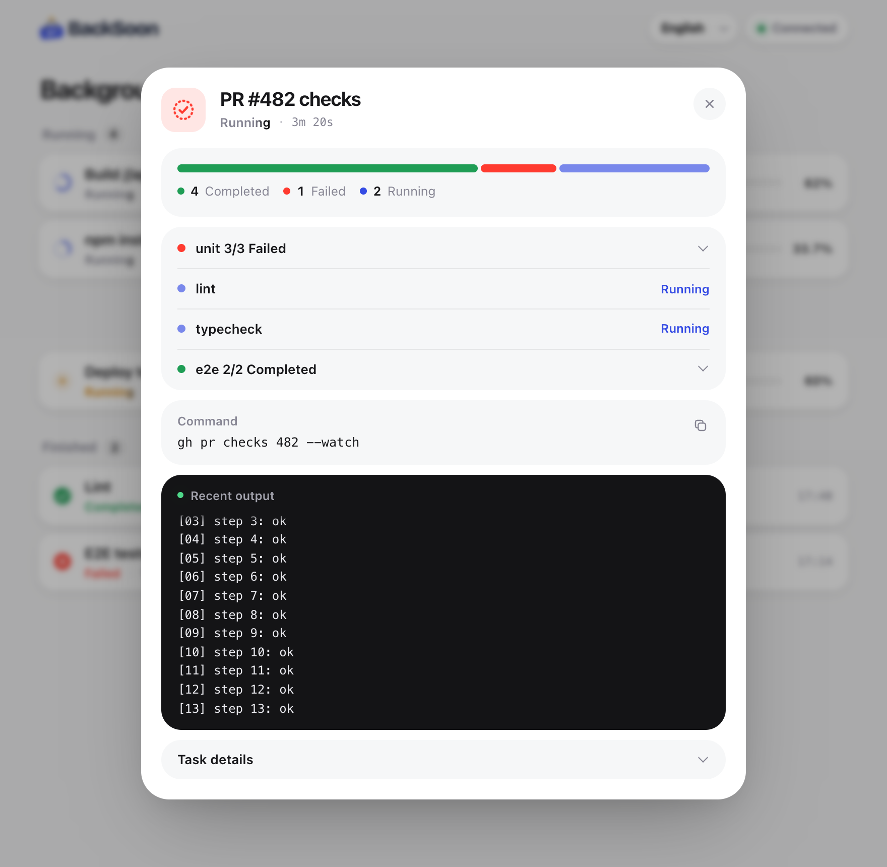

# Usage

[README](../README.md) · Usage · [简体中文](zh-CN/usage.md)

## Commands

Run these in the project that owns the task. Starting a task prints its ID to standard output.

```sh
backsoon start --name "PR checks" -- gh pr checks 42 --watch --interval 30
backsoon start --match 'ERROR' -- tail -n 0 -F app.log
backsoon list
backsoon show TASK_ID
backsoon logs TASK_ID
backsoon stop TASK_ID
backsoon demo
```

`backsoon demo` starts a sample task: a simulated release check of about 40 seconds that shows progress, parallel jobs, a blocker and an estimate in the panel, then reports back like any other task. It changes nothing in the project. Outside a Codex chat it runs for the panel alone.

Arguments after `--` go straight to the executable. Use `sh -c '…'` for pipes or other shell syntax. Use `--cwd` to choose the command's working directory. Stopping a command stops its process group. For a failed command whose intended outcome you have independently verified, use `backsoon resolve TASK_ID --reason "what I checked"`. The panel keeps the original exit code.

For a build followed by installation, start the build with `backsoon start`. In the completion turn, run `backsoon start --after-success BUILD_ID -- INSTALL_COMMAND`. The build must have succeeded. Repeating the same follow-up from the same working directory returns the original installation's ID, including after it finishes. A different command is rejected. If the installation itself fails, check its result before explicitly retrying.

## Open the panel

`backsoon panel` prints a local URL. In Codex desktop the skill opens the panel beside the originating chat. Pass `--no-panel` at startup to skip this. Use `panel --chat CHAT_ID`, `panel --task TASK_ID` or `panel --all` for a specific view. The panel listens on loopback and uses port 47174 by default. Set `BACKSOON_PORT` before starting the service to choose another port. Closing the page leaves tasks running.

The list groups tasks into **Running** and **Finished** and shows each task once. Every row says what its task is doing: a bar and percentage when progress is measured, a moving bar when it is not, one dot per check for `gh` check runs, amber when the task waits or needs input, and the finish time once it ends.

Select a row and its window grows out of it, with the full command and a copy button, live output and details. In a narrow side panel the window rises from the bottom instead. Close it with Escape, the close button or a click outside, and it folds back into the row. The last check time shows when the worker observed the command. The last progress time changes when a reading changes. Animation is skipped when the system asks for reduced motion.

<picture>
  <source media="(prefers-color-scheme: dark)" srcset="images/window-dark.png">
  
</picture>

Direct `gh pr checks --watch` and `gh run watch RUN_ID` commands also read check states from the same repository at the watch interval. The window groups numbered shards and puts failures and requests for input first. A Playwright test run and its browser downloads keep separate readings. Node test summaries and Bazel action counts are recognized from output. Quiet Git transfers show elapsed time.

## Chat notifications

| Option | What happens |
| --- | --- |
| `--notify resume` | Queue the message and ask Codex to resume the originating chat. |
| `--notify steer` (default) | Deliver to the active turn or start a turn for the completion in the same idle chat. Queue the message if the service has not loaded the chat. |
| `--notify queue` | Queue the message for the chat to read later. |
| `--notify off` or `--no-notify` | Keep results in the local panel. |

A task started from inside the Codex sandbox could not reach Codex when it ends, so BackSoon refuses to start one there unless notifications are off. Nothing runs; Codex starts the same command again with escalated permissions.

The destination defaults to `CODEX_THREAD_ID`. Use `--thread CHAT_ID` to choose another chat or `--remote` to select the service that owns it. BackSoon uses the CLI recorded when the task started. A hook can receive a completion while the chat is active.

BackSoon uses the CLI that Codex desktop names in `CODEX_APP_RUNTIME_CLI_PATH` before any `codex` on `PATH`, and adds `--resume` only when its `queue` command accepts it. In Codex desktop, a queued completion goes into the chat’s queue without a resume request, because Desktop starts queued input for a chat it has open and a request would hand the chat to a separate daemon. For a local chat, BackSoon then reads the chat’s history for up to a minute. When a turn carrying the completion appears, `backsoon show TASK_ID` records `state: resumed` and the turn ID. Otherwise it records `state: queued` with `resumed: false`. This happens when Codex desktop has not opened the chat since it started. Opening the chat in Codex starts the queued result; send “continue” there only if it still does not continue. The message is already in the chat’s queue, so BackSoon never sends it again. A disconnect after a direct send leaves delivery uncertain.

A failed command’s notice includes the last lines of output, the latest error line above them, and `backsoon logs TASK_ID` for the full log. If the local service denies access at startup, BackSoon prints the task ID and a warning. Follow the task with `backsoon show TASK_ID`. When the panel offers `backsoon retry-notice TASK_ID`, run it with permission to connect to send the original completion message. This leaves the command’s result intact. If delivery is uncertain, check the destination chat.

## Observe an existing process or chat

```sh
backsoon attach PID --name "Compilation"
backsoon wait-chat CHAT_ID --after-task --timeout 1800
backsoon wait-chat CHAT_ID OTHER_CHAT_ID --timeout 1800
backsoon wait-chat CHAT_ID --final-line "All checks complete"
```

Use the operating system PID for `attach`. Stopping the observer leaves the original process running. BackSoon identifies the original command and its working directory. When standard output or error already goes to a regular text file, it reads new lines for logs and progress. Terminal and pipe output stays with its original reader. The original exit code is available in the terminal that launched the command. An attached GitHub checks watcher can report each check directly, even when its output is in a pipe. Use a progress script to measure other quiet commands.

By default, `wait-chat` waits for the current turn in another local chat, or returns its most recent finished turn. With `--after-task`, it waits for the final reply to a task completion notification. Supply a task ID to find a particular result, including one already in the chat history. With `--final-line`, the last line of a successful reply must match the given text exactly. Choose one of these filters. The timeout is in seconds. Supply several chat IDs to wait for all of them under one task. Each chat has its own status.

You can start waiting before a new chat receives its first prompt. Use `--timeout SECONDS` to limit the wait.

## Task data

Task records and roughly the latest 2 MiB of logs per task live in `.backsoon/` under the current directory. Set `BACKSOON_HOME` to choose another location. Records include command arguments, paths, chat IDs and output. Chat notifications may include matching lines or the last line of output. Check these before sharing logs or screenshots. The default task directory ignores its contents in Git. If you choose a custom directory, add it to your project's ignore rules.

## Progress and alerts

Progress scripts, estimates and alert options are described in [progress and alerts](progress.md).
