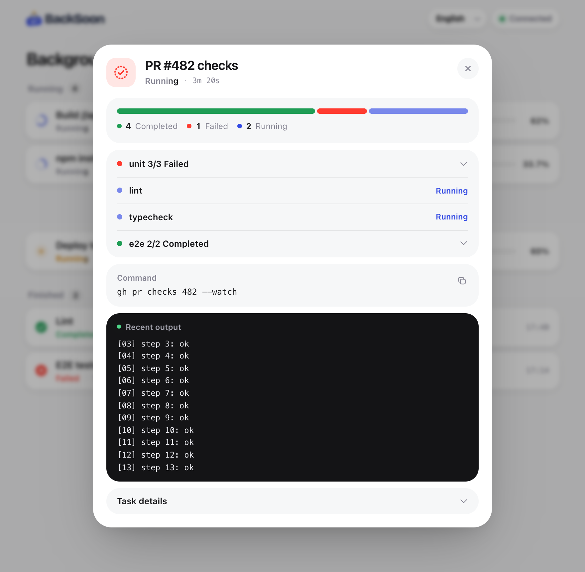

# 使用说明

[README](../../README.zh-CN.md) · 使用说明 · [English](../usage.md)

## 常用命令

在任务所属的项目目录运行：

```sh
backsoon start --name "等待 PR 检查" -- gh pr checks 42 --watch --interval 30
backsoon start --name "监听错误" --match 'ERROR' -- tail -n 0 -F app.log
backsoon panel
```

在 Codex 桌面聊天中让 BackSoon 启动任务或等待聊天，CLI 会准备好本地面板，Skill 会随即在当前聊天右侧打开它。同一聊天的任务共用一个页面。只想后台运行时，可说“这次不要打开面板”，或传入 `--no-panel`。聊天通知开关单独生效。

启动命令的标准输出仍是任务编号。普通终端中可运行 `backsoon panel` 获取网址。点击面板中的任务即可查看命令、输出和聊天通知状态。每一行都说明任务正在做什么：测到百分比时显示进度条，还没有测量值时显示流动的进度条，`gh` 检查每项一个圆点，等待或需要处理时以黄色标出，结束后显示结束时间。面板只监听本机地址。

```sh
backsoon list
backsoon show <任务编号>
backsoon logs <任务编号>
backsoon stop <任务编号>
```

命令报错后，如果单独检查已确认原任务目标完成，可以运行 `backsoon resolve 任务编号 --reason "检查方法及结果"`。面板会显示“已确认完成”和这条说明，详情保留原命令的失败状态与退出码。

同一用户共用本机面板，默认端口是 47174。聊天侧栏打开 `/chats/<聊天编号>`，单项任务的详情在 `/tasks/<任务编号>`，总览在 `/`。分别可用 `backsoon panel --chat 编号`、`backsoon panel --task 编号`、`backsoon panel --all` 取得网址。启动任务或在项目中运行 `panel` 时会登记该任务目录；面板直接读取原有记录。通知关闭或发往其他聊天时，任务仍归发起它的聊天。端口已被其他程序占用时，可在启动服务前用 `BACKSOON_PORT` 选择其他固定端口。

默认向 `CODEX_THREAD_ID` 指定的聊天发送通知。终端中可用 `--thread <聊天编号>`，或用 `--no-notify` 只记录到面板。使用指定的 Codex App Server 时，可设置 `--remote <地址>` 或 `BACKSOON_REMOTE`。命令由原样传入的参数启动，需要管道时可显式使用 `sh -c '...'`。

任务和最近的日志保存在当前目录的 `.backsoon/`。用 `--cwd` 指定命令的实际运行目录，或用 `BACKSOON_HOME` 指定任务保存目录。每项任务保留最近约 2 MiB 日志。停止任务会一并停止同一进程组中的子命令。关闭面板不影响任务，电脑重启后仍可查看记录，原先运行中的任务会标为中断。

任务记录包含完整命令、工作目录、聊天编号和命令输出。开启聊天通知后，匹配的日志和结束时的最后一条输出可能发到目标聊天。Git 默认忽略 `.backsoon/` 中的新文件。如果换用其他名称的任务目录，请把它加入项目的 `.gitignore`。分享日志、面板截图或源码压缩包前，请检查其中是否包含私人信息。

每个任务在列表中占一行。点开后，详情窗口从这一行展开，可查看并一键复制完整命令，也能看到实时输出、上次检查时间和上次有进展的时间。在较窄的聊天侧栏中，窗口从底部弹出。按 Esc、点击关闭按钮或窗口外，窗口会收回到原来那一行。系统开启“减少动态效果”时不播放动画。

<picture>
  <source media="(prefers-color-scheme: dark)" srcset="../images/window-dark.png">
  
</picture>

直接运行 `gh pr checks --watch` 或 `gh run watch 运行编号` 时，BackSoon 会按监听间隔从同一仓库读取检查状态。带有分片编号的检查按名称分组，失败和需要处理的项目优先显示。Playwright 测试和浏览器下载分别记录；Node 测试结果及 Bazel 编译步数从输出中读取。

编译后还要安装时，先用 `backsoon start` 启动编译。收到成功通知后运行 `backsoon start --after-success 编译任务ID -- 安装命令`。重复在同一目录发起同一个安装只会返回已有任务的 ID。若安装失败，先检查结果再决定如何重试。

## 聊天通知

模型在启动每个任务时可以选择通知方式。匹配日志和任务结束都遵循同一设置。

| 参数 | 行为 |
| --- | --- |
| `--notify steer` | 默认方式。将通知送入正在进行的回复；聊天空闲或目标服务未加载聊天时，改为排队并请求唤醒。 |
| `--notify off` | 只更新面板，适合单纯观察进度。原有的 `--no-notify` 仍可用。 |
| `--notify queue` | 把消息放进原聊天的队列，不请求唤醒。 |
| `--notify resume` | 入队并请求原聊天继续处理，适合完成后还要接着做的任务。 |

例如，模型要在编译结束后安装应用，可以运行 `backsoon start --name "编译" --notify steer -- ./build.sh`，随后结束本轮。普通进度更新只显示在面板。

直接通知使用 Codex 的 `turn/steer` 接口。默认连接当前 Codex 用户目录下的本机服务，也可用 `--remote` 指向实际处理这条聊天的服务。桌面版如果在单独的进程中处理聊天，默认服务可能会报告聊天未加载，此时面板会记录改用队列的原因。如果已经发送但没有收到确认，只记录送达情况未知，以免重复通知。


自动继续需要能访问原聊天的 Codex App Server。本机服务可用 `codex app-server daemon start` 启动。使用独立服务时，给 `--remote` 填写创建原聊天的服务地址。Codex 的运行权限需要允许通知命令写入消息数据库或连接指定的服务。

面板分别记录命令的结果和通知的结果。若 CLI 已接受消息，但另一程序正在写入这个聊天，面板会显示 Codex 的恢复警告。此时再次发送会产生重复消息。

启动时会检查能否连接到指定的 Codex 服务。即使恢复闲置聊天的服务暂时连不上，hook 仍有机会在当前回复中送达结果。如果面板显示“通知已排入队列，聊天未恢复”，请在原聊天发送“继续”，无需补发通知。

如果启动任务时缺少连接权限，BackSoon 会提示用 `backsoon show 任务编号` 查看结果。面板显示“补发通知”时，可在获得连接权限后运行 `backsoon retry-notice 任务编号`，将原来的完成通知发到同一条聊天。任务只执行一次。

## 在后台等另一条聊天

可以在 `wait-chat` 后连续指定多个聊天编号，将它们放进同一个任务，等全部结束后通知。窗口里每个聊天都有自己的状态。

`backsoon wait-chat 聊天编号` 会立即返回一个任务编号。后台通过本机 Codex 的聊天记录接口读取目标聊天，等这一轮完成后，把回复摘要送回启动等待的聊天。如果目标聊天最近一轮已经结束，直接取那一轮的结果。可用 `logs` 查看回复，面板和 `stop` 的用法与普通任务相同。

如果目标聊天先启动后台命令，稍后才会收到结果并给出诊断，可以在创建目标聊天后直接运行：

```sh
backsoon wait-chat "$child_chat" --after-task
```

这会跳过“后台任务已启动”的回复和中途的匹配日志，等目标聊天处理结束通知的那一轮完成。知道具体任务编号时，可用 `--after-task "$job_id"` 精确指定，也支持读取已经完成的那次诊断。目标任务需向目标聊天发送结束通知。

目标聊天要处理多项工作时，可以事先请它在全部做完后的回复末尾单独写一行约定的文字，再运行 `backsoon wait-chat "$child_chat" --final-line "全部检查完成"`。两种条件都由 BackSoon 在后台检查。主聊天拿到任务编号后就可以结束本轮。

`--timeout 1800` 可将等待时间限制为 30 分钟，超时按失败回报。等待的是同一台电脑、同一 Codex 用户目录中的聊天，读取记录需要本机 Codex 服务的正常访问权限。有时 Codex 会将另一个进程正在写入的轮次临时标为中断。没有结束时间、实际错误或后续轮次时，BackSoon 会继续等待。`--thread` 指定接收通知的聊天，`--remote` 指定发送通知所用的服务。

## 观察已有的前台命令

`backsoon attach 进程号 --name "编译"` 把等待交给后台，原命令仍在原终端运行一次。这里需要操作系统的进程号，Codex 命令会话编号是另一种编号。面板显示原命令和工作目录。如果标准输出或错误输出已写入普通文本文件，BackSoon 会读取接入后新增的行并识别进度。终端和管道中的输出仍由原程序读取。GitHub 检查可直接查询每一项的状态，其他安静运行的命令可配合进度脚本。退出码可在原终端查看。面板显示“原进程已结束”。停止观察不会停止原命令。可加 `--progress-script` 从原任务已有的日志计算进度。

## 运行中提醒

启动命令时可重复指定要留意的日志内容。例如 `backsoon start --notify steer --alert-on "磁盘已满" "No space left on device" -- ./build.sh`。每个条件首次匹配时会把名称和对应的日志行发回聊天，命令继续运行。

需要根据数字或多次读数判断时，使用 `--progress-script`。脚本每次列出当前成立的条件，例如 `{"alerts":{"失败率过高":"最近 100 条中有 24 条失败"}}`，也可以同时返回进度。条件名保持固定，即使读数变化也只提醒一次。正常时返回 `{"alerts":{}}`，或在有效的进度报告中省略 `alerts`。恢复后再次出现会重新提醒。脚本执行或解析失败不会清除已触发的条件。观察已有进程时，脚本可以读取该进程原有的日志。

提醒沿用任务的 `--notify` 设置。选 `off` 时只在任务详情中记录。收到聊天提醒后，模型可检查相关输出，再决定是否需要干预。

对命令、进程或聊天指定 `--warn-after 1500`，运行到 25 分钟时会提醒一次，任务继续。可按预计用时自选秒数，提醒也遵循通知设置。在使用独立进度脚本时，命令结束后会再测一次；Bazel 输出的已完成步骤数和总数也能直接显示在面板上。
